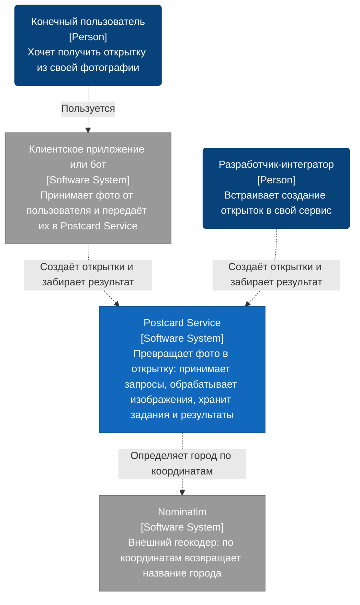
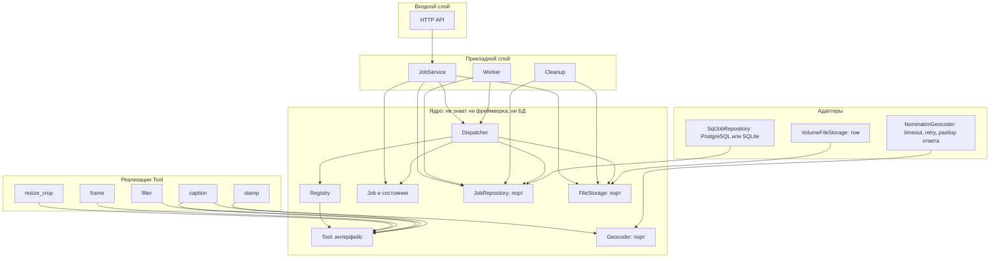
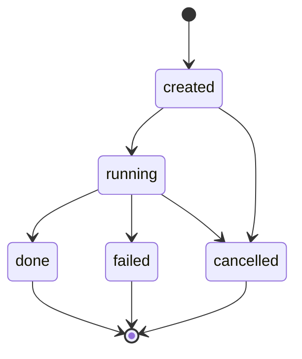

# Архитектура Postcard Service

Документ описывает систему на трёх схемах: контекст, компоненты и жизненный цикл Job.

---

## 1. Контекст

Схема в нотации C4, уровень Context. Тёмно-синим показаны люди, синим наша система, серым внешние системы.

**Что показывают стрелки:** направление вызова. Стрелка идёт от того, кто обращается, к тому, к кому обращаются;
подпись говорит, зачем.

| Взаимодействие | Протокол | Примечание |
|---|---|---|
| Приложение или интегратор → Postcard Service | HTTP, REST, JSON (фото передаётся как `multipart/form-data`) | Наш API работает по HTTP. Шифрование (HTTPS) обеспечивает обратный прокси перед сервисом, в границы проекта оно не входит |
| Postcard Service → Nominatim | HTTPS, JSON | Публичный Nominatim работает по HTTPS |

Внутри Postcard Service есть PostgreSQL и файловый том. На схеме контекста они не показаны (этот уровень не раскрывает устройство системы),
их видно на схеме компонентов.

---

## 2. Компоненты

**Что показывают стрелки:** зависимости кода, а не вызовы по сети. Стрелка `A --> B` означает «код A зависит от B:
импортирует его или использует его интерфейс». Ядро ничего не импортирует из входного слоя, Tool-реализаций и адаптеров.
Наоборот, Tool и адаптеры зависят от интерфейсов ядра (инверсия зависимостей), поэтому ядро тестируется без HTTP и БД.

| Компонент | За что отвечает | Что скрывает от соседей |
|---|---|---|
| HTTP API | Принимает HTTP-запросы, проверяет форму запроса (заголовки, размер, multipart), переводит ошибки в единый формат | От ядра: всё про HTTP, коды ответов и фреймворк |
| JobService | Сценарии «создать, получить, отменить Job»: идемпотентность, проверка плана операций, постановка в очередь | От API: порядок работы с репозиторием, хранилищем и очередью |
| Worker | Берёт Job из очереди и запускает Dispatcher, при старте восстанавливает «осиротевшие» Job | От API: когда и в каком потоке выполняется Job |
| Cleanup | Удаляет файлы с истёкшим сроком хранения и просроченные ключи идемпотентности | От остальных: расписание и способ удаления |
| Dispatcher | Выполняет операции Job по порядку, проверяет отмену между операциями, превращает `ToolResult` в статусы Job | От остальных: какие Tool существуют (знает только Registry) |
| Registry | Находит Tool по имени операции | От Dispatcher: способ регистрации и конкретные классы |
| Tool (интерфейс) | Единый контракт операции: проверить параметры, применить к изображению | От вызывающего: алгоритм обработки и схему своих параметров |
| Job и состояния | Хранит состояние задания и разрешает только допустимые переходы | От остальных: способ хранения |
| JobRepository (порт) | Сохранение и чтение Job, атомарная смена статуса | От ядра: SQL, тип БД, миграции |
| FileStorage (порт) | Запись, чтение, удаление файлов исходников и результатов | От ядра: том это или S3, структуру путей |
| Geocoder (порт) | «Координаты → название города» | От Tool: Nominatim, HTTP, повторы, формат ответа |
| Реализации Tool | Пять операций оформления | Друг от друга и от Dispatcher |
| Адаптеры | Подключают порты к PostgreSQL, тому и Nominatim | От ядра: конкретные технологии |

---

## 3. Диаграмма состояний Job

Состояния `done`, `failed`, `cancelled` конечные: из них переходов нет.

### Состояния

| Состояние | Смысл |
|---|---|
| `created` | Job принят и сохранён, ждёт Worker |
| `running` | Dispatcher выполняет операции. Поле `cancel_requested` показывает, что клиент запросил отмену |
| `done` | Результат сохранён и доступен до `result_expires_at` |
| `failed` | Ошибка в `error.code`: `processing_failed`, `storage_error`, `interrupted` или `internal_error` |
| `cancelled` | Отменён клиентом, промежуточные данные удалены |

### Разрешённые переходы

| Переход | Когда происходит |
|---|---|
| `created → running` | Worker взял Job из очереди |
| `created → cancelled` | Клиент отменил Job до запуска |
| `running → done` | Все операции выполнены, результат сохранён |
| `running → failed` | Ошибка операции или хранилища, либо перезапуск сервиса во время выполнения |
| `running → cancelled` | Клиент запросил отмену, Dispatcher увидел её между операциями |

### Запрещённые переходы

| Попытка | Откуда может прийти | Что ответит система |
|---|---|---|
| `done → cancelled`, `failed → cancelled`, `cancelled → cancelled` | Клиент: `POST /jobs/{id}/cancel` | `409 invalid_transition`, в `details` поля `from` и `to`; статус не меняется |
| `done → running`, `failed → running`, `cancelled → running` (повторный запуск) | Эндпоинта для этого нет | Через API недостижимо. В ядре: `InvalidTransition`, Job не меняется, ошибка в логе |
| `created → done`, `created → failed` (пропуск `running`) | Только баг в коде | `InvalidTransition` в ядре, транзакция откатывается, в логе уровень ERROR; если баг всплыл в запросе, клиент получает `500 internal_error` |
| `running → created` (возврат) | Только баг в коде | То же |

### Почему нет перехода в повторный запуск (retry)

Повторить неудавшееся или отменённое задание можно только новым запросом `POST /jobs` с новым ключом идемпотентности: это новый Job с новым `id`.
Возвращать старый Job в работу мы не стали по трём причинам:

- конечный статус хранит итог (ошибку, время, предупреждения) для диагностики, и этот итог не должен исчезать при повторе;
- файлы исходника и промежуточные данные при сбое или перезапуске удаляются, а срок хранения ограничен, поэтому повторить без повторной загрузки фото часто нечем;
- ключ идемпотентности привязан к одному Job: повтор с тем же ключом возвращает тот же Job, и «воскрешение» его `id` этому противоречило бы.
